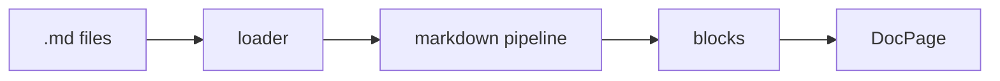

# Markdown features

GitHub-flavored Markdown (tables, task lists, strikethrough, autolinks), plus the
following.

## Callouts

Both spellings render as a kui `Callout`:

```md
> [!TIP] Faster builds
> Content is parsed once, at build time.

:::warning Breaking change
Renaming a file changes its URL.
:::
```

> [!TIP] Faster builds
> Content is parsed once, at build time.

:::warning Breaking change
Renaming a file changes its URL.
:::

Kinds: `note`, `tip`, `info`, `important`, `warning`, `caution`, `danger`. Put more
colons on the outer fence to nest admonitions.

## Code

Fences are highlighted at build time with highlight.js and get a copy button. A
`title` attribute replaces the language label:

````md
```ts title="lib/docs.ts"
export const docs = createDocsRoutes({ config, collection: 'docs' });
```
````

## Diagrams

A `mermaid` fence renders as a diagram. The library loads only when the diagram
scrolls into view.



## Heading anchors {#anchors}

Headings get GitHub-style ids for the "On this page" list and deep links. Append
`{#custom-id}` to a heading to choose the id yourself.
